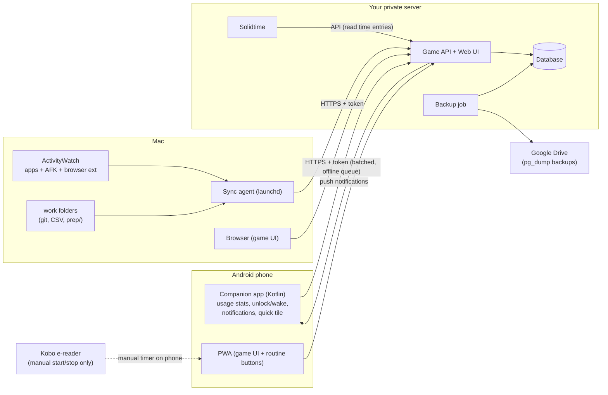
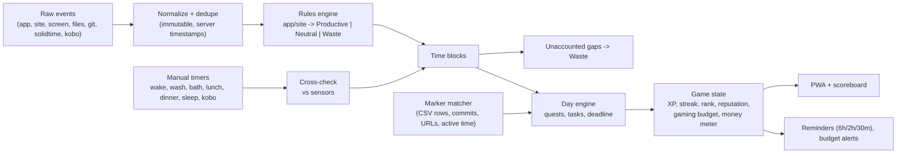
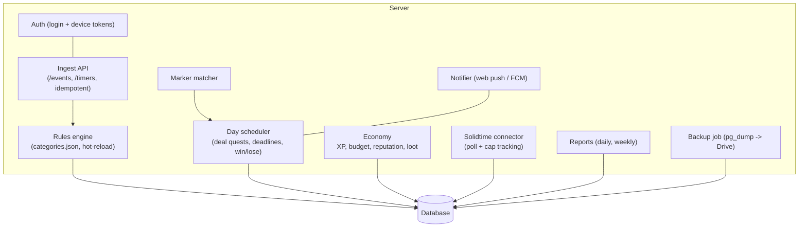
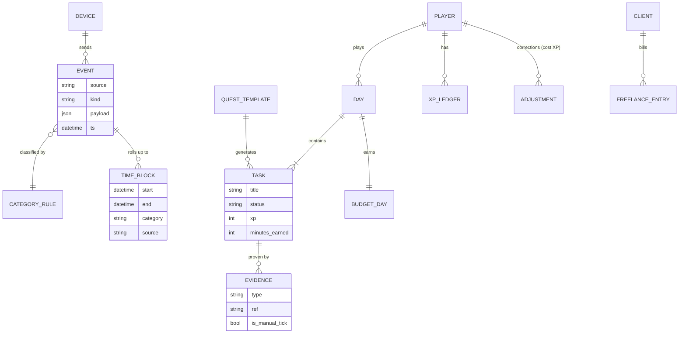
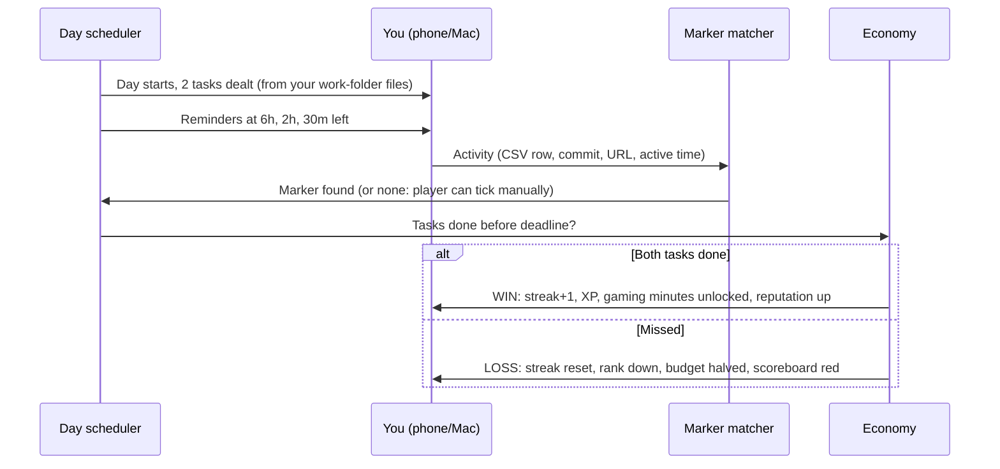
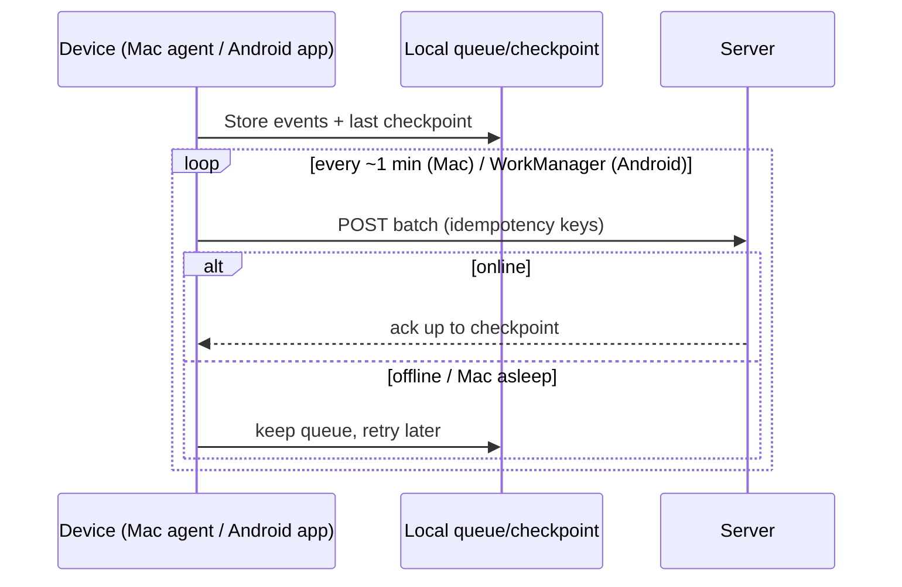

# Architecture

## 1. System context

## 2. Data flow (sensor to score)

## 3. Server components

## 4. Data model

## 5. Daily cycle lifecycle

## 6. Sync with offline catch-up

## 7. How data is collected per device
| Device | Method | Notes |
|---|---|---|
| Mac | ActivityWatch REST (`/api/0/buckets`, `/api/0/buckets/<id>/events`) read by a `launchd` agent, checkpoint per bucket | Needs macOS Accessibility (and maybe Screen Recording) permission for window titles |
| Mac browser | ActivityWatch web watcher extension | Chrome-family and Firefox supported; Safari needs checking |
| Android | Own Kotlin app: `UsageStatsManager` + screen/unlock broadcasts, uploaded by WorkManager | One-time "Usage access" grant; battery-optimisation exemption recommended |
| E-reader | Manual start/stop timer on the phone | No data import |
| Solidtime | Server polls its API | Token set by you in server config |
| work-folder | Agent watches `git log` and the CSV/prep files, ignores `.env` | Mac only, so evidence arrives when the Mac is on |

## 8. Security and privacy
- HTTPS only; single user login plus per-device revocable tokens.
- All data on your server; plain `pg_dump` backups uploaded to your personal Google Drive.
- No secrets in the sync agent; file watcher ignores `.env`, keys and credential files.
- Browser tracking stores domain and page title by default; full URLs are optional (see Doubts file).
