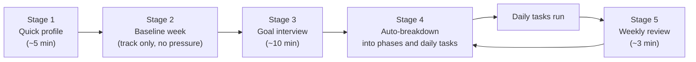

# Onboarding: how the app learns what to ask of you

Problem: the app can't invent useful tasks without knowing your big goals, your real schedule, and what time you can give. Asking 100 questions on day 1 fails (people quit), and people answer wishfully ("I'll study 4 hours a day").

Approach: **ask little, observe a lot, then refine every week.**

## Stage 1: Quick profile (about 12 questions, 5 minutes)
Purpose: set safe defaults so the app works on day 1.

| # | Question | Type | Feeds |
|---|---|---|---|
| 1 | Timezone and your usual day-end time (when would a "day" feel finished)? | time | `day.ends_at` |
| 2 | When do you usually wake and sleep now? (ranges, e.g. wake 1-4 pm) | time ranges | baseline, wake ramp |
| 3 | When would you *like* to wake and sleep? | time | wake/sleep goal |
| 4 | How fast should that change? Very slow (about 15 min per week or less) / Slow / Normal / I'll set it myself | choice | ramp step |
| 5 | How do you want to record wake-up: tap "I'm up" / detect from phone use / wearable | choice | wake source |
| 6 | Which devices should be tracked: Android phone, Mac, e-reader (manual), others? | multi | collectors |
| 7 | Which browser(s) on your computer? | multi | extension setup |
| 8 | Which apps/games do you want limited? (pick from a list, add your own) | multi | gaming apps |
| 9 | How much play time per day is OK as a maximum? | minutes | `gaming.daily_cap_minutes` |
| 10 | What kind of consequences do you want when you miss a day? Just show data / gentle / gradual / harsh | choice | pressure level |
| 11 | How long do meals, washing and bath usually take? | minutes | Neutral time defaults |
| 12 | Quiet hours and days off (e.g. festival days, travel)? | times/dates | reminders, pause days |

Everything is changeable later; defaults are conservative.

## Stage 2: Baseline week (no tasks, no penalties)
For 7 days the app only **observes**. Nothing is judged. At the end it shows:
- actual wake and sleep times (median and spread)
- productive / neutral / waste split and top 20 apps and sites
- how long you stay on gaming apps and when you start them (trigger times)
- longest focused stretch and when it happens
This answers "how does my mind and day actually work" with data, not wishes. It also sets realistic starting levels: if you focus for 20 minutes at a time, tasks start at 10-20 minutes.

On day 3 the app asks you to **label the top apps/sites** (Productive / Neutral / Waste / Gaming), one tap each. This builds `categories.local.json`.

You may skip the baseline and start immediately; tasks then start at the smallest size.

## Stage 3: Goal interview (about 10 minutes, repeated per goal; start with 1-3 goals)
Pick a template, then answer the questions. Templates give sensible defaults for questions the user can't answer yet.

Templates: **Get a job**, **Learn a skill**, **Freelance income**, **Health / sleep**, **Project**, **Custom**.

For each goal:

| # | Question | Why |
|---|---|---|
| G1 | What is the outcome, in one sentence? ("Get an Android role", "Finish course X") | goal title |
| G2 | By when? (date or "in about N weeks/months"; or "no deadline") | pace |
| G3 | How will you know it's done? (a number if possible: 30 applications, 3 offers, a project shipped) | progress meter |
| G4 | Where are you now? (nothing started / some prep / ready to apply) | starting phase |
| G5 | Roughly how many hours per week can you honestly give? (choose lower if unsure) | capacity |
| G6 | What usually stops you from starting? Don't open it / get distracted / overwhelmed / stall at the hard bit / fear of rejection | task size and ordering |
| G7 | What proves work on this goal? Pick from: a folder or repo, a spreadsheet/CSV, a website (full URLs allowed for public sites), an app, a time-tracker project | evidence markers |
| G8 | Which parts feel easy and which scary? | order phases easy to hard |
| G9 | Any fixed dates (interview, exam, delivery)? | hard deadlines |

Questions for the player's broader life (asked once): other commitments, hard fixed hours, energy by time of day.

## Stage 4: Automatic breakdown (goal into phases, weeks, daily tasks)

Algorithm (deterministic, no AI needed for v1; AI suggestions can be added later):

1. **Phases**: from the template (e.g. Get a job: *Prepare* -> *Research targets* -> *Apply* -> *Interview prep* -> *Interviews*), ordered easy to hard, stretched to fit G2. The progress meter is phase progress plus G3.
2. **Weekly target** per phase = remaining units / remaining weeks (units like applications, study blocks, problems solved).
3. **Capacity check**: weekly target x unit minutes must be <= G5 hours. If not, the app says so and offers a longer timeline or a smaller target, instead of silently overloading you.
4. **Daily tasks**: split the weekly target across days into tasks of **5-25 minutes**. Size starts from the baseline's focus stretch and G6:
   - "don't even open it" -> a *Kickoff* task first (2 minutes: open the laptop and the site)
   - "overwhelmed" -> smaller tasks, one step each
   - "fear of rejection" -> order easy, then apply, then mock interview
5. **Ramp**: start at **1-2 tasks/day** for the first two weeks. Add a task only after the previous level was done on most days (default 5 of 7 days). Never add more than one task per week.
6. **Rewards**: `reward_per_task = min(60, daily_cap / tasks_required)`. As tasks go up, reward per task goes down; the daily cap stays.
7. **Markers**: each task has a marker taken from G7 (a new CSV row, commits in a folder, minutes on a listed site, time in an app). Markers are soft; the player can also tick a task manually.
8. **Fixed dates (G9)** pull relevant phases earlier and add milestone tasks.

Example (fake data), "Get a job", 8 weeks, 6 h/week, hard to start:
- Week 1 *Research targets*: tasks "Kickoff" + "Add 1 company" (10 min)
- Week 2 *Prepare*: "25-min study block" x1/day
- Week 3-5 *Apply*: "Log 1 application" 3 days/week plus study block
- Week 6-8 *Interview prep*: mock interview and practice problems

## Stage 5: Weekly review (3 minutes)
Every week the app shows last week's data and asks:
1. Was the load right? (too light / right / too heavy) -> adjusts the ramp.
2. Which tasks did you skip, and why? (not clear / too big / no time / didn't want to) -> resizes or removes them.
3. Anything changed? (new deadline, trip, illness) -> pause days or re-plan.
4. Mood this week (1-5, optional) -> shown next to productivity over time.
Plus a monthly and a 6-month view so the long trend is visible.

## Paused days
A player can pause tracking for a day or more. The app asks the reason (family, travel, festival, illness, other), does not penalise it, and shows it as a labelled gap in reports.

## Data produced
- `config/profile.local.yml` (gitignored): answers from Stages 1-3
- `config/goals.local.yml` (gitignored): goals, phases, weekly targets
- `config/quests.local.yml` and `config/categories.local.json`: generated and editable
Fake examples of the first two are in [`config/onboarding.example.yml`](../config/onboarding.example.yml).

## Open design questions
- Should the goal interview be a web form, a chat-style flow, or both? (Proposal: step-by-step web form with a chat-style option later.)
- Should the breakdown stay rule-based, or call an LLM for custom plans? (Proposal: rules for v1; LLM later, optional, with the player's own API key.)
