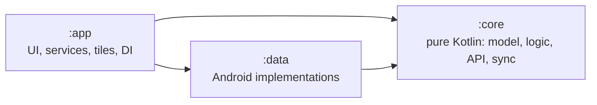
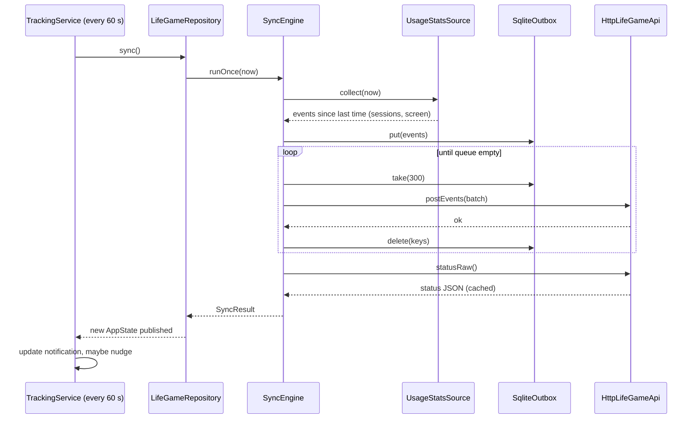

# Android app: architecture

The app is a thin companion to the Life Game server. It measures phone usage, shows the day countdown, and offers quick actions. Almost all rules live on the server; the phone keeps only what it must do offline or in real time.

See [SPEC.md](SPEC.md) for what the app must do and [../ANDROID.md](../ANDROID.md) for installing it.

## Modules



| Module | Type | Contains | May depend on |
|---|---|---|---|
| `:core` | Kotlin/JVM library | models, session building, event mapping, nudge rules, API client, sync engine, repository | only the Kotlin standard library and coroutines |
| `:data` | Android library | SharedPreferences store, encrypted token, SQLite queue, UsageStats reader | `:core` |
| `:app` | Android application | Compose UI, view models, foreground service, job, boot receiver, quick-settings tiles, notifications, dependency container | `:core`, `:data`, Compose |

**The rule that keeps this clean:** `:core` has no Android classes. Everything it needs from the platform is an interface (a *port*) that `:data` or `:app` implements. That is why 68 of the tests run on a plain JVM in about a second, and why the logic cannot quietly depend on the platform.

## Packages

```
core/src/main/kotlin/app/lifegame/core/
  json/         Json writer and reader (no library)
  model/        Status, OutEvent, TimerKind
  usage/        RawEvent, Session, SessionBuilder, EventMapper
  net/          LifeGameApi (interface), HttpLifeGameApi, ApiException
  sync/         ports (ConnectionStore, UsageSource, EventQueue, SyncStateStore, PlayerPreferences, ApiFactory), SyncEngine
  nudge/        Nudger, NudgeState, NudgeMemory
  format/       Format (durations, countdown text, one-line summary)
  repository/   LifeGameRepository, AppState
core/src/testFixtures/  in-memory fakes for the ports, shared with other modules' tests

data/src/main/kotlin/app/lifegame/data/
  settings/     SettingsStore (implements 4 ports), SecretBox (Keystore AES-GCM)
  queue/        SqliteOutbox (EventQueue)
  usage/        UsageStatsSource (UsageSource), UsageAccess

app/src/main/kotlin/app/lifegame/companion/
  LifeGameApp.kt        Application; owns the container
  di/                   AppContainer: builds the object graph by hand
  system/               TrackingService, SyncJobService, BootReceiver, QuickTiles, Notifier,
                        PermissionChecker, TrackingController
  ui/theme/             colours, typography, shapes, status colours
  ui/components/        SectionCard, ProblemBanner, PermissionRow, live clock
  ui/today/             TodayScreen, TodayViewModel, TodayUiState
  ui/setup/             SetupScreen, SetupViewModel, SetupUiState
  ui/navigation/        AppNavigation (bottom bar, two destinations)
  ui/MainActivity.kt
```

## Data flow



If any call fails, events stay in the queue, the error is stored, and the next round retries. Nothing is deleted until the server has accepted it.

## State management

- **One source of truth:** `LifeGameRepository.state` (a `StateFlow<AppState>`). It is rebuilt from the stores after every action.
- **Unidirectional flow:** screens observe state and call functions on the view model; the view model calls the repository; the repository updates the stores and publishes new state.
- **One `UiState` per screen** (`TodayUiState`, `SetupUiState`). Composables take that value and callbacks only, so they can be previewed and have no hidden state. Only the live clocks keep local state, and only where they are drawn.
- **One-off messages** (snackbar text after a tap) go through a `Channel` in the view model, not through `UiState`, so they are shown once.
- The service, the tiles and the job all use the same repository, so the notification, the tiles and the screens agree.

## Threading

| Work | Where |
|---|---|
| UI | main thread; Compose only draws state |
| `sync()`, `wake()`, timers, save and test | `Dispatchers.IO` inside the repository |
| Service loop | a `SupervisorJob` scope on `Dispatchers.Default`, cancelled in `onDestroy` |
| Sync rounds | serialised by a lock in `SyncEngine`, so a tile tap and the service never overlap |
| SQLite queue | `@Synchronized` methods |

## Dependency injection

`AppContainer` builds everything once and is created lazily by `LifeGameApp`. The graph is small, and every dependency is an interface from `:core`, so a framework would add weight without adding safety. View models get their dependencies through a `ViewModelProvider.Factory` in `AppNavigation`.

## Errors

| Layer | Behaviour |
|---|---|
| `HttpLifeGameApi` | maps HTTP status to a readable `ApiException` (401 token refused, 5xx server problem, 4xx with the server's message) |
| `SyncEngine` | catches every failure, turns network exceptions into sentences, stores the last error, never throws to callers |
| Repository actions | return `Result`; the view model turns failures into a snackbar message |
| Service and job | wrap risky calls (`runCatching`) so a failure in a bonus (the job) cannot stop the service |

## Testing strategy

| Level | What | Where | Speed |
|---|---|---|---|
| Unit, pure JVM | session building, JSON, mapping, nudges, formatting, API client against a local server, sync engine, repository | `:core` (68 tests) | about 1 s |
| View model | state mapping, messages, save and test, permissions, tracking switch | `:app` (16 tests, fakes from `:core` test fixtures) | about 2 s |
| Emulator, manual | service, notification countdown, usage upload, tiles, both themes | scripted with `adb` against a throwaway server | minutes |
| Not automated yet | Compose UI tests, instrumented tests, real-device battery behaviour | | |

## Build setup
- Gradle 9.4.1, Android Gradle Plugin 9.1.1 with built-in Kotlin 2.2.10, version catalog in `gradle/libs.versions.toml`.
- `compileSdk` 36, `targetSdk` 35, `minSdk` 29 (the usage events the app relies on exist from API 29).
- Compose BOM 2025.06.00 with Material 3; no other UI libraries.
- Third-party runtime libraries: none beyond Compose, AndroidX lifecycle/activity, and kotlinx.coroutines.

## How to add a feature
1. Put rules and data shapes in `:core` (plain Kotlin) and test them there.
2. If it needs the platform, define a port in `:core` and implement it in `:data`.
3. Add the action to `LifeGameRepository` and expose the new data in `AppState`.
4. Add the field to the screen's `UiState`, handle it in the view model, draw it in the composable, add a preview.
5. Write down the requirement in `SPEC.md` and link the test.

## Decisions
| Decision | Why |
|---|---|
| No Hilt or Koin | about eight objects; manual wiring is clearer and has no build cost |
| No Room | the queue is one table with replace semantics; raw SQLite is shorter and removes an annotation-processing step |
| No WorkManager | the foreground service is the main loop; a plain `JobScheduler` job is enough as a backup and avoids a large dependency tree |
| No Retrofit or OkHttp | four endpoints; `HttpURLConnection` is enough and is tested against a real local server |
| No navigation library | two top-level destinations; a saved enum is simpler |
| Foreground service type `specialUse` | tracking and countdown fit no other category; the app is sideloaded, so no Play review applies |
| Server owns the rules | the phone shows server state and queues events; it never decides what counts as a win or a loss |

## Known limits
- Sideloaded debug build only; no release signing flow yet.
- Not yet checked on Samsung One UI's battery management.
- The nudge only warns; it cannot block an app.
